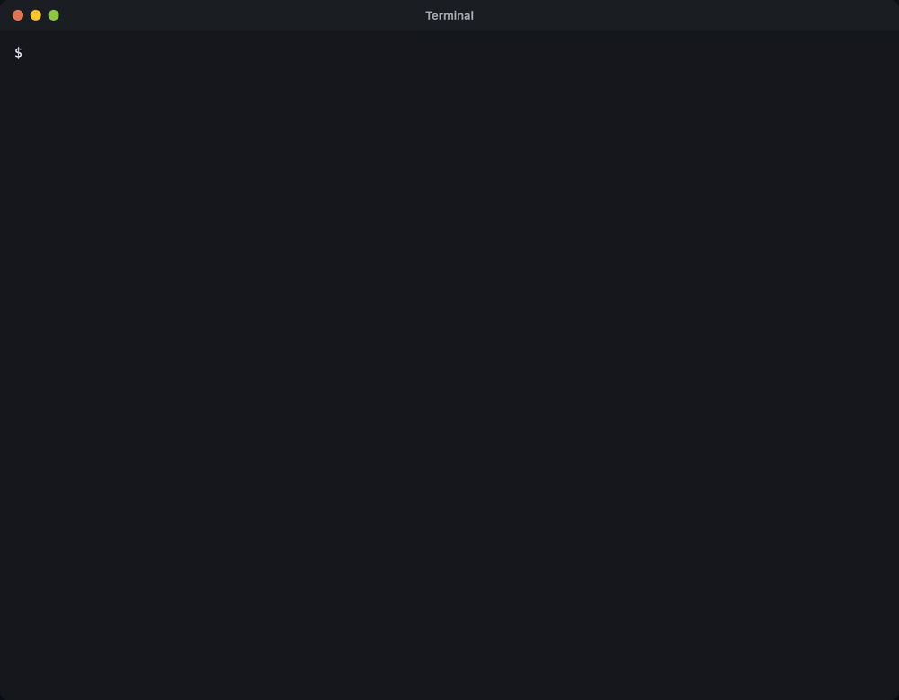
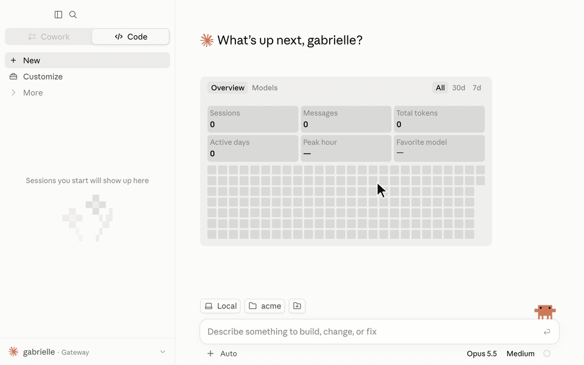

# <picture><source media="(prefers-color-scheme: dark)" srcset="docs/leverage-dark.svg"></picture> Claude on Leverage

<a href="LICENSE"></a>
<a href="https://github.com/leverage-computer/claude-plugin/actions/workflows/ci.yml"></a>
<a href=".claude-plugin/plugin.json"></a>
<a href="#requirements"></a>

[Features](#features) · [Recordings](#recordings) · [Install](#install) ·
[Usage](#usage) · [leverage.computer](https://leverage.computer)

[](docs/setup.mp4)

## Features

- [**Multiplayer harness**](#multiplayer-harness): shared visibility of our
  messages, status, typing indicators inside of Claude Code.
- [**Company computer**](#company-computer): one session, two places. Turns run
  in Leverage, so Claude Code needs no model sign-in. Text and thinking stream
  as Leverage writes them.
- [**Steering**](#steering): Enter over a running turn steers it. ctrl+x enter
  keeps the prompt in Claude Code's queue, where you can edit it or take it
  back, until its turn starts.
- [**Governance**](#governance): approvals and questions show in Claude Code's
  own dialogs.

## Recordings

### Multiplayer harness

[](docs/teammates.mp4)

### Company computer

[](docs/first-session.mp4)

### Steering

[](docs/steering.mp4)

### Governance

[](docs/approvals.mp4)

### The Leverage pane

[](docs/sessions.mp4)

The pane lists your spaces, their sessions. A session you open shows its whole
history: prompts, text, tool calls and results. `/leverage` opens the pane
again.

### Also

- **Subagents** run Leverage subagents as Claude Code's own agents.
- **`/leverage help`** lists the actions you can do with Leverage mod.

## Install

### Requirements

- Claude Code 2.1.286 or later
- A Leverage account

```sh
claude plugin marketplace add leverage-computer/claude-plugin
claude plugin install leverage@leverage
```

### Claude Desktop

Claude Desktop's Code tab runs Claude Code, so the plugin works there too.
Add it from Claude Desktop's plugin directory:

1. Open Customize → Plugins and click Discover.
2. Click +, then Add from a repository.
3. Enter `leverage-computer/claude-plugin` and click Sync.
4. Open Leverage and click Install.

[](docs/claude-desktop.mp4)

## Usage

- `/leverage login`: sign in, and approve in the browser.
- `/leverage`: open the pane.
- Press a session to run it here: click it, or ctrl+x tab, Tab to it, Enter.

To start a new session in a space, use the Leverage CLI:

```sh
leverage claude <space>
```

## License

[MIT](LICENSE)
